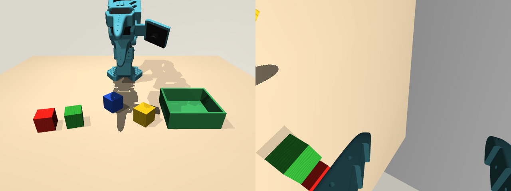

# SO-101 tabletop (MuJoCo)

A LeRobot [EnvHub](https://huggingface.co/docs/lerobot/envhub) environment: an SO-101 arm in the turquoise of the LeRobot kits, four painted wooden 3 cm cubes (red, green, blue, yellow) and a green open box on a table in a simple room, simulated with MuJoCo. Each reset places the cubes, the box and the front camera with seeded offsets.



An Isaac Sim version with the same layout, cameras, observations and actions is [`lerobot/so101-tabletop-isaac`](https://huggingface.co/lerobot/so101-tabletop-isaac): the same policies and commands run against both.

| | |
|---|---|
| Observation | `pixels`: `front` (scene camera) and `wrist` (gripper camera), 480×640 RGB; `agent_pos`: 6 joint positions |
| Action | 6 absolute joint position targets: `shoulder_pan`, `shoulder_lift`, `elbow_flex`, `wrist_flex`, `wrist_roll` in degrees, `gripper` 0-100 (the units of LeRobot's `so101_follower` with `use_degrees=True`) |
| Control rate | 30 fps |
| Task | "Put all the cubes in the green box." |
| Reward | the fraction of cubes in the box at each step (0, 0.25, ... 1); `info["cubes_in_box"]` gives the count |
| Episode end | success (terminated) when all four cubes are in the box; truncated after 3600 steps (2 minutes), set with `episode_length` |
| Reset | seeded cube and box poses, front camera jitter, joint noise |

## With the LeRobot simulator server

From a LeRobot checkout, start the server. The image installs `requirements.txt`, and `env.py` declares the control rate and joint names in `LEROBOT_SIM`:

```bash
lerobot-env-server --envhub=lerobot/so101-tabletop-mujoco --docker=true
```

Then drive it as a robot, here with a policy:

```bash
lerobot-rollout --robot.type=sim \
  --robot.env.type=envhub --robot.env.hub_path=lerobot/so101-tabletop-mujoco --robot.env.task=so101_tabletop \
  --robot.env.server.endpoint=tcp/127.0.0.1:7448 \
  --policy.path=<your SO-101 checkpoint> --fps=30
```

Without `--robot.env.server.endpoint`, the same command runs the environment in-process (with `--robot.env.trust_remote_code=true` and the requirements installed next to LeRobot). `lerobot-eval` takes the same options as `--env.*`, e.g. `--env.type=envhub --env.hub_path=lerobot/so101-tabletop-mujoco --env.task=so101_tabletop`.

Observations reach policies as `observation.images.front`, `observation.images.wrist` and `observation.state`; use `--rename_map` if your checkpoint names its cameras differently.

## In-process

```python
from lerobot.envs.configs import HubEnvConfig

envs = HubEnvConfig(hub_path="lerobot/so101-tabletop-mujoco", trust_remote_code=True).create_envs(n_envs=1)
```

`make_env_kwargs` (`--env.make_env_kwargs` on the command line) override the defaults of `SO101Env` in `env.py` (episode length, image size, cameras, initial joints, reset randomization). Headless machines need `MUJOCO_GL=egl`.

## Files

| File | Content |
|---|---|
| `env.py` | the EnvHub entry point (`make_env`), the Gymnasium env and `LEROBOT_SIM` |
| `so101_tabletop.xml` | the scene: room, table, cubes, box, lights, front camera and the arm's mount site |
| `robotstudio_so101/` | MuJoCo Menagerie's SO-101 model, attached at the mount site (`env.py` recolors its printed parts) |
| `textures/wood.png` | a seamless wood grain, tinted per cube |

## Licenses

- This environment is Apache-2.0, including `textures/wood.png` (generated procedurally for it).
- `robotstudio_so101/` is MuJoCo Menagerie's SO-101 model (commit `0059d4335f8156206f63a35662313385f7ad6d74`), derived from TheRobotStudio's SO-ARM100, under the Apache-2.0 license in that folder.
